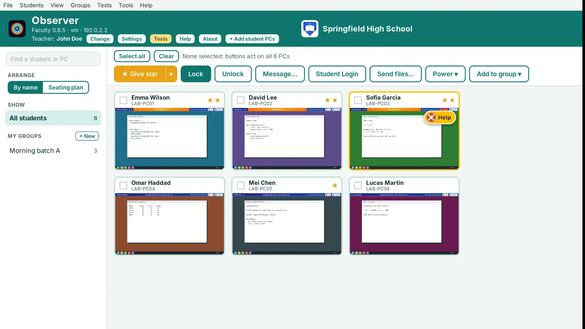
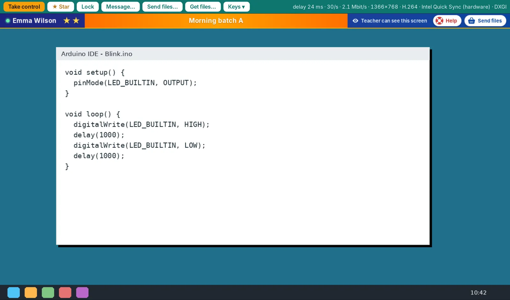
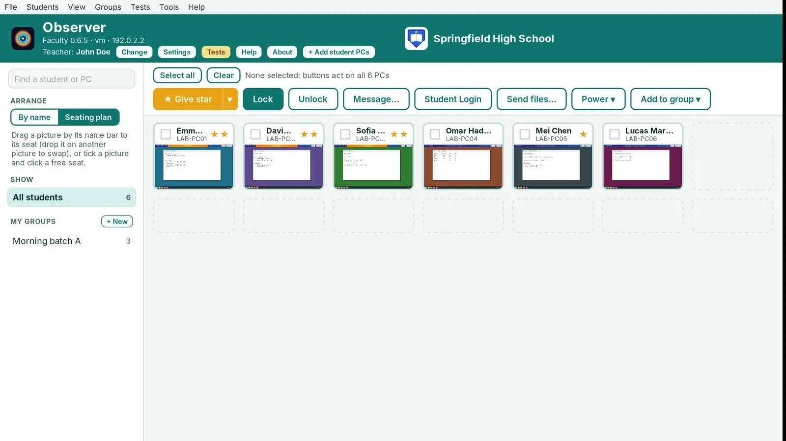
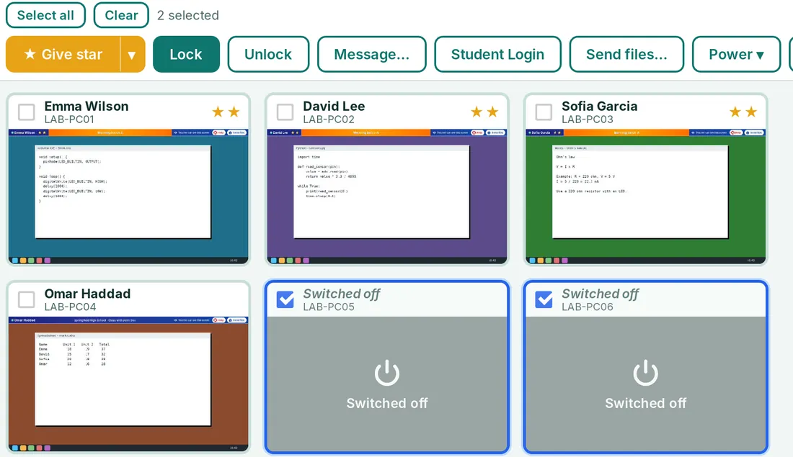
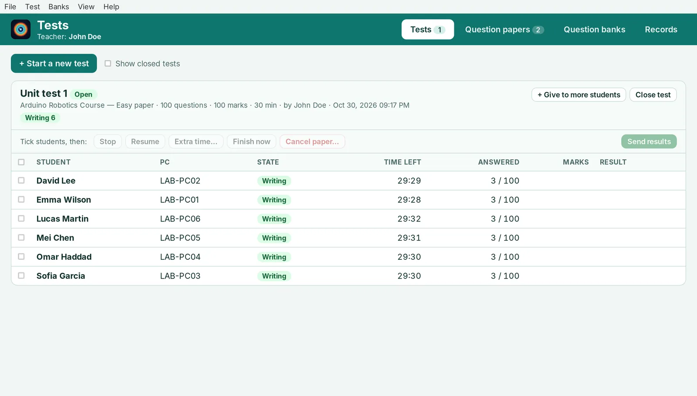
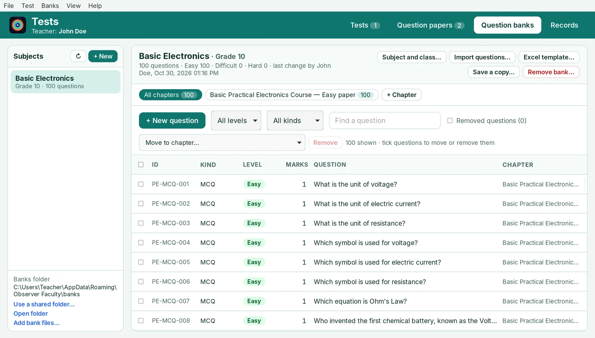

<p align="center"></p>

<h1 align="center">Observer</h1>
<p align="center"><b>Classroom monitoring and testing for computer labs</b><br>
Windows 10 and 11 (64-bit) · Available on the Microsoft Store</p>

<p align="center"><a href="https://apps.microsoft.com/detail/9NB0C23C6SBK"><b>Get Observer Faculty</b></a> &nbsp;·&nbsp; <a href="https://apps.microsoft.com/detail/9NNJ78GZVPBX"><b>Get Observer Student</b></a></p>

---

## Overview

**Observer** helps a teacher run a computer lab from one PC. The teacher sees every student's screen live, can take control of any PC, lock screens, send messages and files, switch PCs on and off, and give tests from their own question banks.

Observer comes as two programs:

| Program | For | Notes |
|---|---|---|
| **[Observer Faculty](https://apps.microsoft.com/detail/9NB0C23C6SBK)** | the teacher PC | Free to download. Works fully for a free week (no card needed), then a yearly subscription is required |
| **[Observer Student](https://apps.microsoft.com/detail/9NNJ78GZVPBX)** | every student PC | Free. Starts with Windows and finds the teacher PC by itself |

Everything stays inside the school's own network. Observer needs no internet, and every link between the PCs is encrypted.

## Get Observer

Both programs are on the Microsoft Store:

- **Observer Faculty** (teacher PC): [apps.microsoft.com/detail/9NB0C23C6SBK](https://apps.microsoft.com/detail/9NB0C23C6SBK)
- **Observer Student** (every student PC): [apps.microsoft.com/detail/9NNJ78GZVPBX](https://apps.microsoft.com/detail/9NNJ78GZVPBX)

Student PCs can also be set up from a command prompt:

```
winget install 9NNJ78GZVPBX --source msstore
```

**Getting started**

1. Install Observer Faculty on the teacher PC and open it. Your free week starts now.
2. Install Observer Student on each student PC and open it once. After that it starts by itself when Windows starts.
3. In Observer Faculty, press **+ Add student PCs**. Type the 6-digit code it shows into the **Join your teacher** box on each student PC.
4. The student PCs appear as live pictures. Group them, arrange a seating plan and start teaching.

The yearly subscription is bought inside Observer Faculty with the **Subscribe** button, through the Microsoft Store. The price for your country is shown in the Store.

## Features

**Watching and control**
- Live pictures of every student screen, in a grid or in your own seating plan.
- A big, sharp live view of any student, with very low delay (hardware H.264 video from Windows' own encoder).
- Take control of a student PC's mouse and keyboard.
- Show the teacher's screen to the whole class.
- Search students by name or PC.

**Classroom tools**
- Lock and unlock screens, send messages.
- Send files to students, and get files from student PCs.
- Help button: a student asks for help and the teacher sees a blinking sign on that student's picture.
- Stars for good work, and groups (batches) of students.
- Student Login: work follows the student's name, not the PC.

**Power**
- Restart or shut down student PCs.
- Switch shut-down PCs back on (Wake-on-LAN). A switched-off PC stays in the list as a grey tile.

**Tests and question banks**
- Question banks for any subject, with chapters and Easy / Difficult / Hard levels.
- Eight kinds of questions, including multiple choice with more than one answer, numbers and pictures.
- Import questions from Excel or CSV.
- Start a test on chosen students, stop, resume, give extra time, then mark it and send results.
- Records of every student's marks.

**Easy to use**
- Menu bar with keyboard shortcuts in every window.
- Light and dark themes, larger text, your school's name and logo.
- Built-in Help guide (also as a PDF).
- Sharp at every display scaling from 100% to 300%.

## Screenshots

| Main window | Big live view |
|:---:|:---:|
|  |  |

| Seating plan | Switched-off PCs |
|:---:|:---:|
|  |  |

| A running test | Question banks |
|:---:|:---:|
|  |  |

The strip students see while a teacher is connected:


## System requirements

- Windows 10 or 11, 64-bit.
- Teacher and student PCs on the same local network (wired or Wi-Fi).
- Microsoft Edge WebView2 Runtime (already part of Windows 10 and 11).
- Switching PCs on needs a wired network connection and Wake-on-LAN allowed on the PC.

## Privacy

Observer collects no personal data and sends nothing to the internet. Read the full [Privacy Policy](PRIVACY.md).

## Technology

Tauri v2 and Rust, with Windows' built-in WebView2. Screen capture by DXGI Desktop Duplication and video by Windows Media Foundation (graphics-chip encoder when available). Links are encrypted with X25519 key exchange and ChaCha20-Poly1305.

## Contact

- Website: [https://vsa.edu.in/](https://vsa.edu.in/)
- E-mail: [softinquiry@vsa.edu.in](mailto:softinquiry@vsa.edu.in)
- More software: [github.com/dsvakola/software](https://github.com/dsvakola/software)

---

Designed and developed by **Prof. Dattaraj S. Vidyasagar** and **Prof. Yash D. Vidyasagar**, for **Vidyasagar Academy**.
Copyright © 2026 Vidyasagar Academy. All rights reserved.
